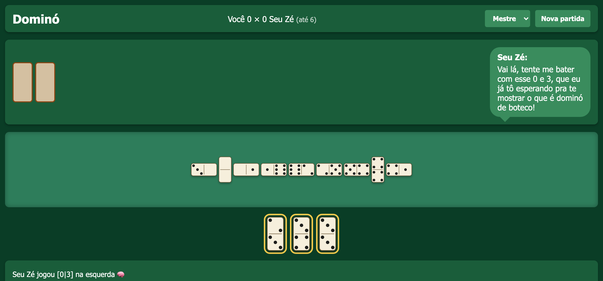

# Dominó contra o Seu Zé

A Brazilian block dominoes game for the browser. You play against **Seu Zé**, a bar regular who teases you in Brazilian Portuguese between moves. His lines, and his move choice on the hardest level, come from a language model running on your own machine through [Ollama](https://ollama.com).

The game logic never depends on the model. If Ollama is missing, slow, or returns something odd, the engine plays the move itself and Seu Zé uses a canned line, so the game always works.



## Quick start

You need:

- **Node.js 20 or newer** (no npm packages to install, the project has zero dependencies)
- **Ollama** (optional, only for Seu Zé's talk and the Mestre level)

```bash
git clone https://github.com/danielpsf/domino-seu-ze.git
cd domino-seu-ze

# Optional: give Seu Zé a voice
ollama pull qwen3:8b

npm start
```

Open http://localhost:5173, pick a level and click **Nova partida**.

## Levels

| Level | How the bot picks a move | What the model does |
|---|---|---|
| Fácil | A random legal move | Nothing |
| Médio | The heaviest tile, doubles first on a tie | Nothing (canned lines) |
| Difícil | A heuristic: dump heavy tiles, keep control of the open ends, avoid opening numbers you probably hold | Teases you after each move |
| Mestre | The engine shortlists its 3 best moves and the model picks one | Picks the move and teases you |

The server never sends the bot your hand, and every move from the model is checked against the engine's list of legal moves before it's played.

## Rules and scoring

Block dominoes with a double-six set: 28 tiles, 7 per player, no drawing. If you can't play, you pass. Full rules in [RULES.md](RULES.md).

Bar scoring, first to **6 points**:

- **Batida** (you play your last tile): 1 point
- **Batida de carroça** (your last tile is a double): 2 points
- **Jogo trancado** (nobody can play): 1 point to the lighter hand, nobody scores on a tie

## Configuration

All optional, set as environment variables:

| Variable | Default | What it does |
|---|---|---|
| `PORT` | `5173` | Port the game listens on (localhost only) |
| `OLLAMA_URL` | `http://localhost:11434` | Where Ollama runs |
| `DOMINO_MODEL` | `qwen3:8b` | Any chat model you have in Ollama |
| `DOMINO_BUSY_CMD` | unset | A shell command whose output starts with a verdict word. If it prints `SATURATED` or `DOWN`, the bot skips the model for that turn. Useful on a laptop that also runs other AI jobs. |

Example with a different model:

```bash
DOMINO_MODEL=qwen3-coder:30b npm start
```

Any model works for the banter. For Mestre the model has to return JSON, so prefer regular builds over MLX builds, which can't do Ollama's JSON mode yet.

Every model call is logged to `logs/llm-calls.jsonl` with its latency, tokens per second and status, so you can compare models.

## Project layout

```
engine.mjs      Rules: deal, legal moves, apply a move, game over, blocked-game winner
ai.mjs          Bot strategies: random, greedy, heuristic ranking
match.mjs       Hands, forced 6-6 opening, bar scoring, match to 6
server.mjs      Zero-dependency HTTP server, game state, Ollama calls with timeouts and fallbacks
public/         The game screen (one HTML file, SVG tiles, works on a phone)
test/           node:test suites for the engine, the bot and the scoring
scripts/        simulate.mjs plays full matches against every level through the API
```

## Tests

```bash
npm test
```

18 tests, including 200 random games that check the tile chain never breaks, a test that fails if the bot reads your hand, and full matches played to 6 points.

To play automated matches against a running server:

```bash
npm start          # in one terminal
npm run simulate   # in another
```

## Troubleshooting

- **Seu Zé only says canned lines.** Ollama isn't running or the model isn't pulled. Run `ollama list` and check that `qwen3:8b` (or your `DOMINO_MODEL`) is there.
- **The first bot move takes a few seconds.** That's Ollama loading the model into memory. Later moves are fast.
- **Port already in use.** Start on another port: `PORT=5180 npm start`.

## Background

This game started as a test project: the same build tasks were given to 53 AI models, local and cloud, and graded by these tests. Local models were the right fit for Seu Zé himself (fast, free, and fun), while the cloud models were better at writing the code.

## License

[MIT](LICENSE)
